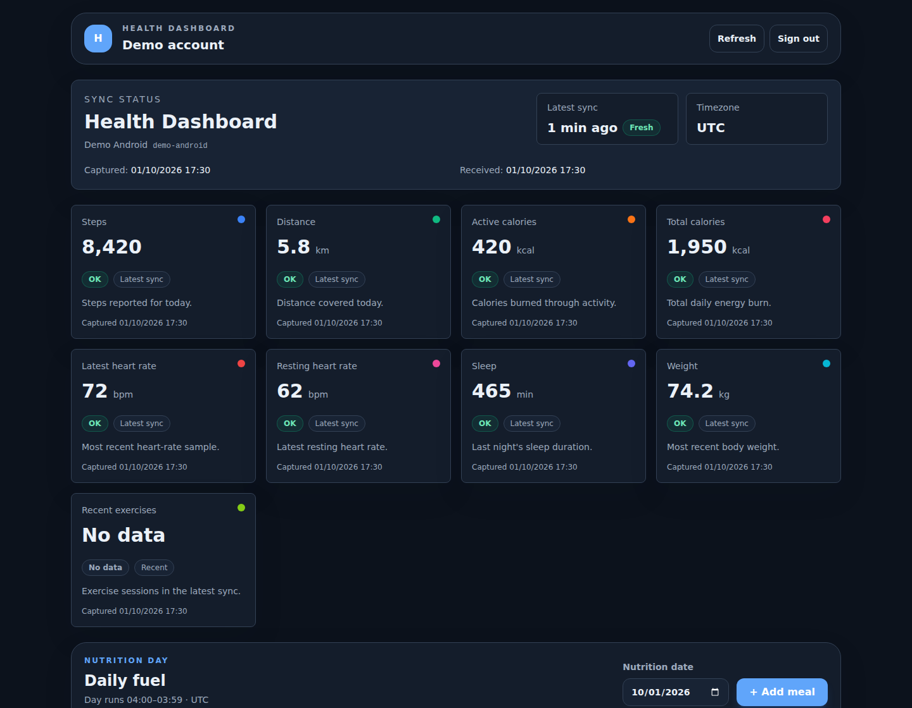
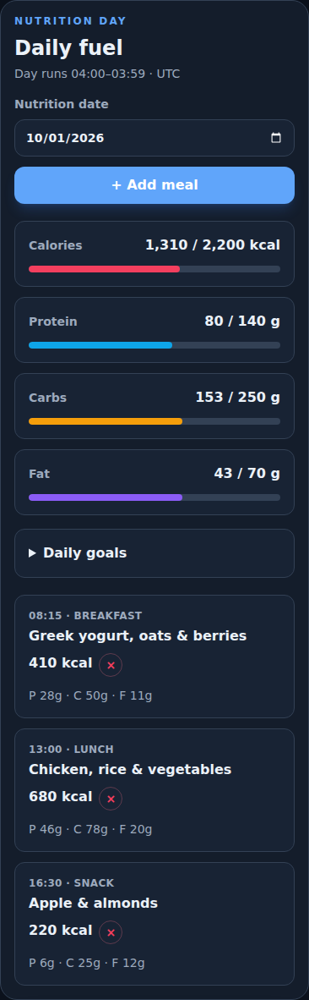
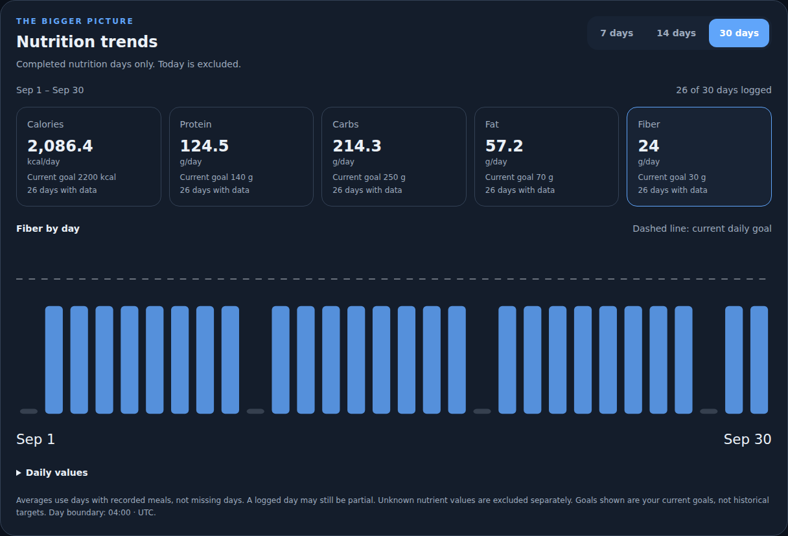

# Health Dashboard + Android Companion

Your health metrics and nutrition journal, on your own server. A React dashboard and a native Kotlin / Jetpack Compose Android app share one account, one set of nutrition goals, and one nutrition-day boundary.

[Download Android APK](https://github.com/Uriel1010/health-dashboard/releases/download/android-production-v0.3.1/app-release.apk) · [Production release](https://github.com/Uriel1010/health-dashboard/releases/tag/android-production-v0.3.1) · [All releases](https://github.com/Uriel1010/health-dashboard/releases) · [API documentation](docs/USER_API.md)



*Actual dashboard UI with synthetic demo data. Screenshots contain no personal health records, credentials, or real device identifiers.*

## What it does

| Web dashboard | Android companion |
| --- | --- |
| Health snapshots, device history, and sync freshness | Read supported health metrics from Health Connect |
| Meal registration, meal lists, and deletion | Review server meals and daily nutrition progress |
| Per-user calorie and macro goals | Calorie ring, protein/fiber progress, and recent meals |
| Account-specific nutrition-day reset | Home-screen nutrition summary and rings widgets |
| 7-, 14-, and 30-day completed-day averages | Trends screen, daily charts and configurable average widgets |
| Multi-user accounts and per-user ingest tokens | Verified in-app release downloads and Android installer handoff |

The Android app is primarily a companion to server-registered meals. Manual meal entry is available when needed. Notifications are discovered on refresh or scheduled sync; they are **not instant push notifications**.

## Nutrition, at a glance

Daily goals and meal totals follow the account's reset hour and server timezone. For example, with a 04:00 reset, a meal at 02:00 belongs to the previous nutrition day.

<p align="center">
  
</p>

*Mobile web dashboard, shown with sample meals. This image is not a native Android screenshot.*



*Version 0.3 uses the last 7, 14 and 30 completed nutrition days, excluding today. Averages use recorded days; missing days are not zero. Coverage is shown separately for every nutrient, including unknown fiber values. Screenshots use synthetic data.*

In Android, open **Trends** for statistics and **Settings → Home screen widgets** to choose wide progress bars, compact rings or a configurable average widget. Each average widget has its own period and nutrient. See the [0.3 calculation and design specification](docs/V0.3.md).

## Run the dashboard

Requirements: Docker with Docker Compose, and a private location for deployment configuration and backups.

```sh
git clone https://github.com/Uriel1010/health-dashboard.git
cd health-dashboard
cp .env.example .env
```

1. Edit `.env`. Set a unique database password and long random ingest token. Keep the password in `DATABASE_URL` consistent with `POSTGRES_PASSWORD`.
2. Start the stack:

   ```sh
   docker compose up -d --build
   ```

3. Create the initial administrator using the interactive management command:

   ```sh
   docker compose run --rm api python -m app.manage
   ```

4. Open **http://localhost:3016** and sign in. The API is exposed on port **8015** by default.
5. Generate your account's ingest token from **Account & ingestion**, then configure your Android app.

For existing deployments, follow the [multi-user upgrade instructions](docs/MULTI_USER_UPGRADE.md) before applying migrations. Use [backup and restore](docs/BACKUP_RESTORE.md) instructions to protect your database.

For remote access, deploy behind HTTPS, set `SESSION_COOKIE_SECURE=true`, and explicitly configure your allowed origins. The optional Cloudflare tunnel profile requires your own tunnel token. Never commit `.env`.

## Install Android

**Minimum Android version: 9 / API 28.** Health features additionally require Health Connect availability, a data-producing app, and the relevant permissions.

1. Download the [production APK](https://github.com/Uriel1010/health-dashboard/releases/download/android-production-v0.3.1/app-release.apk).
2. Verify its SHA-256 against the [release checksums](https://github.com/Uriel1010/health-dashboard/releases/download/android-production-v0.3.1/SHA256SUMS).
3. Install the APK and enter your server URL and dashboard account in Settings. Configure the account ingest token for health uploads and meal writes.
4. Grant the Health Connect permissions you want to use. Optionally enable new-meal notifications and add a nutrition widget from your launcher.

Health Connect and source-app permissions control which metrics are available. Writing a meal to Health Connect does not guarantee another health app will immediately display it.

### Updates and signing

The app checks GitHub releases when opened and from **Settings → App updates**. Downloads are verified by SHA-256, package ID, numeric version code, and signing certificate before Android's installer is opened. Installation requires user approval.

| Distribution | Release tags | Intended use |
| --- | --- | --- |
| Android production | `android-production-vX.Y.Z` | Optimized, non-debuggable APK with a private production signing identity |
| Android development | `android-vX.Y.Z` | Debug-signed prereleases for testing |
| Dashboard | `dashboard-vX.Y.Z` | Dashboard source and frontend build |

**Moving from development to production is not an in-place update.** The two distributions have different signing certificates. Do not uninstall your existing app without planning for local settings and app-owned Health Connect data. Server meal records remain on the server.

The production release also includes a signed AAB for possible future store submission. This project has not been submitted to or approved by Google Play. See [production signing](docs/PRODUCTION_SIGNING.md) and [publishing Android updates](docs/ANDROID_RELEASES.md).

## Project layout

```text
health-dashboard/
├── backend/                    FastAPI, PostgreSQL, accounts, nutrition APIs
├── frontend/                   React, TypeScript, Vite dashboard
├── android/HealthConnectTest/   Kotlin / Jetpack Compose Android app
├── docs/                       Setup, API, security, release guides, screenshots
└── scripts/                    Backup, restore, and release helpers
```

## Development and checks

Frontend, from `frontend/`:

```sh
npm ci
npm run build
```

Backend, in a Python environment with `backend/requirements.txt` installed, from `backend/`:

```sh
python -m unittest discover -s tests -v
```

Android, with the Android SDK configured locally, from `android/HealthConnectTest/`:

```sh
./gradlew assembleDebug testDebugUnitTest
# Windows PowerShell: .\gradlew.bat assembleDebug testDebugUnitTest
```

Production builds require an external private signing configuration. Signing keys, passwords, SDK paths, database exports, and health records do not belong in Git.

## Documentation

- [Daily nutrition goals in web and Android](docs/NUTRITION_GOALS.md)
- [User API guide](docs/USER_API.md)
- [API manual](docs/API_MANUAL.md)
- [Administrator API](docs/ADMIN_API.md)
- [Accounts and multi-user setup](docs/MULTI_USER_UPGRADE.md)
- [Database backup and restore](docs/BACKUP_RESTORE.md)
- [Android release workflow](docs/ANDROID_RELEASES.md)
- [Production signing and migration](docs/PRODUCTION_SIGNING.md)
- [Screenshot provenance](docs/images/README.md)
- [Security and privacy](SECURITY.md)

This project is not a medical device. Automated secret scanning and verified release checksums do not replace a security review of your deployment.
